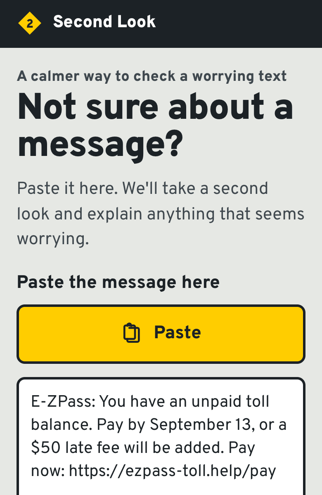
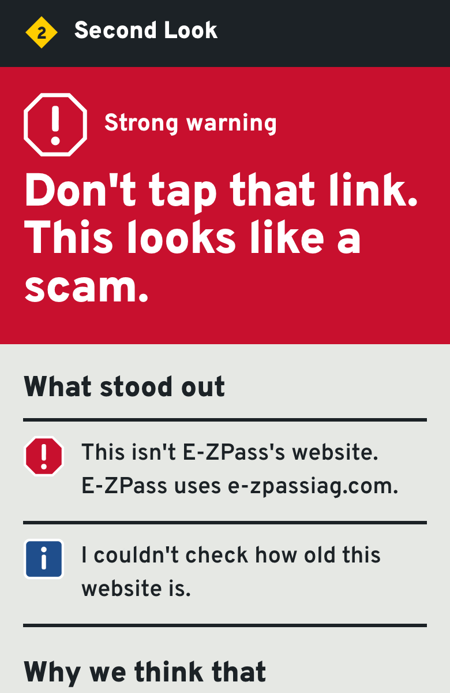
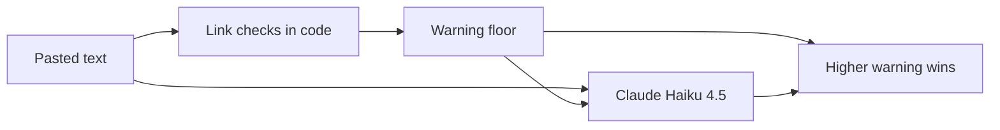

# Second Look

Got a text that feels off?
Paste it into Second Look and get a plain-English verdict, plus the evidence behind it.
It is built for people who are not technical and just want to know whether to worry.

Live: [secondlook.selimd.me](https://secondlook.selimd.me)

 

## How it works

1. Code pulls out every link and checks it: how new the domain is (RDAP), whether it imitates a known brand, free hosting, short links, and Google Safe Browsing.
2. Those checks set a warning floor.
3. One Claude Haiku 4.5 call reads the message with that evidence and explains the result in plain English.
4. The higher of the two warnings wins, so the model can raise the warning but never lower it.

A scam that claims to be "verified safe" cannot talk its way past the link checks.
The lowest result Second Look gives is "No red flags found"; it never calls a message safe.

## Results

On held-out test messages, with the prompt frozen before testing:

- Scams caught: 84 of 100 scam texts were flagged.
- False alarms: 6 of 180 genuine texts were flagged.

The sample is small and the test scams had their links removed, so these numbers come with wide error bars.
See [the evaluation write-up](eval/RESULTS.md) for the method, confidence intervals, link results, and limitations.

## Privacy

Second Look stores no user data: there is no database, and message text is never logged.
To do the checks, the message goes to Anthropic's API, full links go to Google Safe Browsing, domain names go to their registry, and known short links are sent to their short-link service only to read where they redirect.
The destination link is never opened.

## Tech stack

Next.js, React, TypeScript, Tailwind CSS, the Anthropic SDK, and Vitest.

## Data and attribution

See [Data and attribution](docs/data.md) for dataset sources, licenses, and the Google Safe Browsing advisory.
