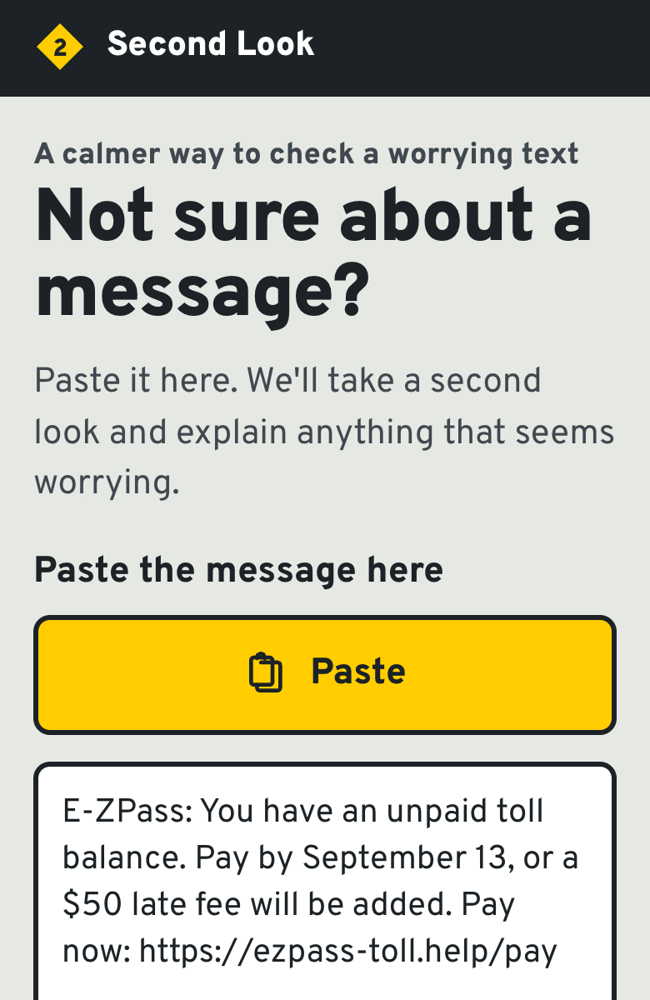
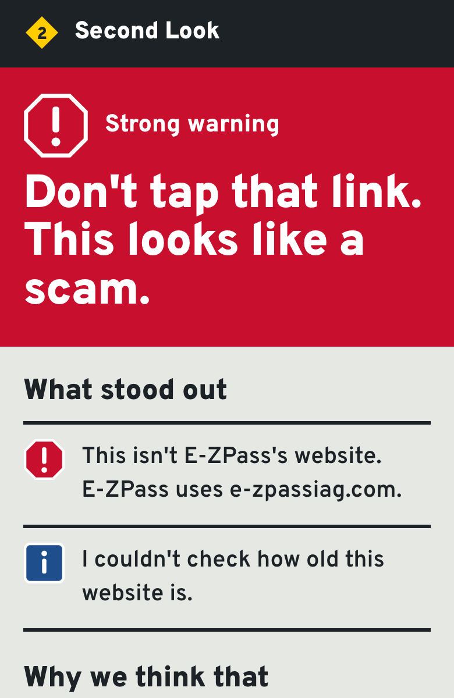
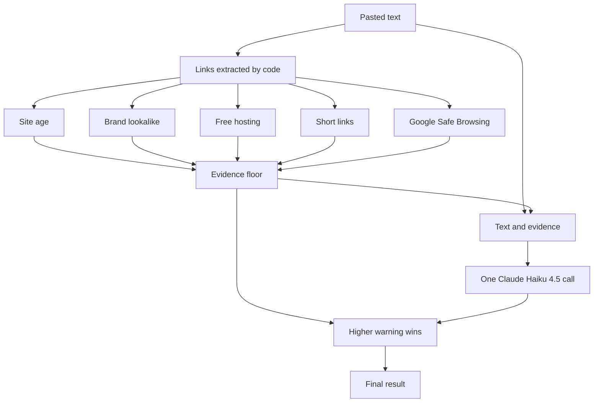

# Second Look

Second Look helps non-technical people check a worrying text message and understand the evidence behind the answer.

Live: [secondlook.selimd.me](https://secondlook.selimd.me)

 

## Results

- Scams caught: 84 of 100 held-out scam texts were flagged.
- False alarms: 6 of 180 genuine texts were flagged.

See [the full evaluation write-up](eval/RESULTS.md) for the full numbers and method.

## How it works

Second Look separates facts it can check in code from the judgment needed to read a message in context.
It runs every link check, asks Claude Haiku 4.5 for one short plain-English reading, and returns whichever warning level is higher.

Evidence outranks the model, so a scam that claims to be "verified safe" cannot talk its way to a lower warning.
The page never calls a message safe, legitimate, or verified; its lowest result is "No red flags found."

## Privacy

Second Look itself stores nothing: there is no database, and message text is never logged.
The message text goes to Anthropic's API, which [normally deletes inputs and outputs within 30 days](https://privacy.claude.com/en/articles/7996866-how-long-do-you-store-my-organization-s-data) and [does not use them for training by default](https://privacy.claude.com/en/articles/7996868-is-my-data-used-for-model-training); complete URLs go to Google Safe Browsing; domain names go to the relevant registry; and known short links are sent to their short-link service only to read redirect headers.
The destination link is never opened.

## Data and attribution

See [Data and attribution](docs/data.md) for dataset sources, licenses, and the Google Safe Browsing advisory.
